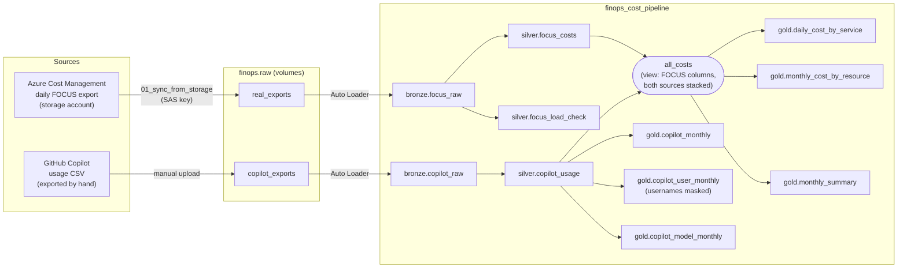
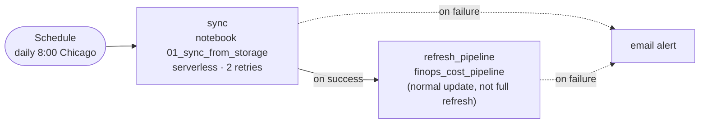

# Azure cost + GitHub Copilot → Databricks

A daily pipeline that pulls Azure cost exports and GitHub Copilot usage into one place in Databricks, checks them, and turns them into report-ready tables. Built as a learning project at Zeal IT Consultants to find out what it takes to bring several cost sources together, and as a hands-on path for people studying for the Databricks Data Engineer Associate certification.

**Status (Oct 28, 2026):** runs daily as the job `finops_daily`. Real data: one Azure subscription (Skunkworks) and one month of Copilot usage.

---

## Straight answers

### What does this add beyond Azure Cost Management?
If the only question is "what did Azure cost?", **nothing**. Azure Cost Management already answers it, and this project only adds cost and work. It's worth it when you need one of these:

1. **More than one source in one place.** Copilot spend lives in GitHub, not Azure. Here both sit in the same tables, in the same columns, so one report shows both.
2. **Usage and value, not just dollars.** Who uses Copilot, which models, how many credits against the quota, and what that usage would cost at list price. Azure Cost Management can't show any of that.
3. **Our own rules and checks.** Re-sent months are deduplicated, every load is checked against Azure's own row count, and bad data stops the pipeline before anyone sees it.
4. **Control over who sees what.** Analysts can read the report tables; usernames are masked for everyone outside an admin group.
5. **A measured answer to "what does it take?"** One daily run takes about 2 minutes. The build steps are in the commit history.

### How does it combine sources?
Every source is reshaped into the same standard columns, **FOCUS** (the FinOps Open Cost and Usage Specification, which Azure exports natively), and then **stacked**, not joined. One view, `all_costs`, holds the stack, and every report table reads from it.

| FOCUS column | Azure row | Copilot row |
| --- | --- | --- |
| ProviderName | Microsoft | GitHub |
| ServiceCategory | Storage, Compute, … | AI and Machine Learning |
| ServiceName | the Azure service | GitHub Copilot |
| ResourceName | the Azure resource | the AI model |
| BilledCost | what Azure invoices | what GitHub invoices (`net_amount`) |
| ListCost | price before discounts | credits at list price (`gross_amount`) |

**What this does not do:** link an Azure row to a Copilot row. There's no shared key: Copilot has GitHub usernames, Azure has resources. Cost per project across both providers would need a small mapping table (Copilot repository → project, Azure tag or resource group → project).

### How do I add another source?
1. Land its files in a volume (for example `finops.raw.<source>_exports`).
2. Add a bronze streaming table in `04_pipeline_bronze.py` (Auto Loader, everything as text).
3. Add a silver materialized view in `05_pipeline_silver.py` (types, deduplication, data quality rules).
4. Map it into the FOCUS columns and add it to `all_costs` in `06_pipeline_gold.py`.

Steps 1–3 are new code. Step 4 is about 15 lines, and every gold table picks the source up with no other changes. A natural third source is Databricks' own bill (`system.billing.usage`).

### What's automated and what isn't?
| Source | How it arrives | Automated? |
| --- | --- | --- |
| Azure FOCUS export | Azure writes files to a storage account; the job copies new ones each morning | **Yes**, as long as the export is scheduled in Azure and the access key is valid |
| GitHub Copilot usage | CSV exported by hand from GitHub billing and dropped in a volume | **No**. The job processes it automatically once it's there. GitHub's billing API could automate the download (separate work). |

### Is the data real?
Yes. Azure data is real FOCUS exports from one subscription; Copilot data is a real usage report. Neither is committed to this repo (see Data safety).

### What does a daily run cost?
About 2 minutes of serverless compute per day. The dollar cost hasn't been measured yet; Databricks' `system.billing.usage` table can show it.

---

## How it fits together

### Data flow

### The daily job

`sync` copies only new or changed files. `refresh_pipeline` runs only if sync succeeded, so the pipeline never sees half-copied files. Jobs run the pipeline in production mode (automatic retries, compute shut down afterwards). First run: sync 23 s, pipeline 1 min 43 s.

**Why a schedule and not "run when a file arrives":** Databricks can only watch storage that Unity Catalog manages. The Azure storage is reached with a SAS key from Python, so Databricks can't see files land there. Identity-based access would make event-driven runs possible.

---

## What each file does

| File | Runs as | Produces |
| --- | --- | --- |
| `00_setup.ipynb` | Once, by hand | Catalog `finops` (managed storage in ADLS), schemas `raw`, `bronze`, `silver`, `gold`, volumes `raw.real_exports` and `raw.copilot_exports` |
| `01_sync_from_storage.py` | Job task `sync` | Copies new or changed export files from the Azure storage account into `raw.real_exports`, keeping Azure's folder layout. Safe to re-run. |
| `04_pipeline_bronze.py` | Pipeline source | `bronze.focus_raw`, `bronze.copilot_raw` |
| `05_pipeline_silver.py` | Pipeline source | `silver.focus_costs`, `silver.focus_load_check`, `silver.copilot_usage` |
| `06_pipeline_gold.py` | Pipeline source | View `all_costs` and the six gold tables |
| `07_governance.sql` | By hand | Analyst grants on gold; the username mask function `finops.governance.mask_username` |
| `02_bronze_copy_into.ipynb`, `02_bronze_auto_loader.py` | By hand | Learning steps: the same bronze load done with COPY INTO and standalone Auto Loader. Not part of the daily flow. |
| `practice notebooks/` | By hand | Labs: COPY INTO with time travel; Auto Loader schema evolution. |

---

## Tables

Everything lives in catalog `finops`. **Streaming tables** only add new rows. **Materialized views** are recomputed so they always match their sources, which is what lets a re-sent month replace old rows.

### Bronze: raw, exactly as delivered
| Table | Type | One row per | Contents |
| --- | --- | --- | --- |
| `bronze.focus_raw` | Streaming table | Row in an Azure FOCUS export file | Every column as text, plus `source_file`, `source_modified_at`, `ingested_at`. Keeps **every** export run, including older versions of the same month. |
| `bronze.copilot_raw` | Streaming table | Row in a Copilot usage CSV | Every column as text, plus the same lineage columns. Contains usernames. |

### Silver: cleaned, deduplicated, checked
| Table | Type | One row per | Contents |
| --- | --- | --- | --- |
| `silver.focus_costs` | Materialized view | Azure charge, **newest export run of each month only** | FOCUS columns with proper types (costs as decimals, dates as timestamps), `billing_period`, `run_id` |
| `silver.focus_load_check` | Materialized view | Billing month | The run kept, `loaded_rows` vs `manifest_rows` (Azure's own count), `covers_until` |
| `silver.copilot_usage` | Materialized view | Day × user × model × repository (newest file wins) | Typed amounts and token counts, `usage_month`. Contains usernames. |

### Gold: report-ready
| Table | Sources | One row per | Answers |
| --- | --- | --- | --- |
| `gold.daily_cost_by_service` | Azure + Copilot | Day × provider × service | Daily trend: billed, effective, list cost |
| `gold.monthly_cost_by_resource` | Azure + Copilot | Month × provider × resource | What costs the most, and on how many days |
| `gold.monthly_summary` | Azure + Copilot | Month × provider | Headline totals, savings vs list price, resource counts |
| `gold.copilot_monthly` | Copilot | Month | Credits used, active users, how many seats' worth of included credits that is |
| `gold.copilot_user_monthly` | Copilot | Month × user | Credits, active days, models, share of the org total. **Username masked** outside `finops_admins`. |
| `gold.copilot_model_monthly` | Copilot | Month × model | Model mix: credits, users, share of the month |

**Copilot note:** included credits are pooled across seats, and while usage stays within the quota, `BilledCost` is $0. Copilot's value shows in **credits used vs the quota** and **list cost**, not billed cost.

---

## Data quality checks

Rules run inside the pipeline. **Warn** keeps the row and counts it, **drop** removes the row, **fail** stops the whole update so nobody sees bad numbers.

| Where | Rule | Action |
| --- | --- | --- |
| `silver.focus_costs` | Costs parse as numbers; billed cost ≥ 0; billing period found in the file path | Warn |
| | Charge has a date | Drop |
| | Currency is USD | Fail |
| `silver.focus_load_check` | A manifest exists for the run | Fail |
| | Rows loaded = rows in the manifest | Fail |
| `silver.copilot_usage` | Amounts parse; gross = credits × price | Warn |
| | Usage has a date | Drop |
| | Unit is `ai-credits` | Fail |
| `gold.monthly_summary` | Total is not NULL | Fail |
| `gold.copilot_monthly` | Credits × $0.01 = list cost | Warn |
| | Active users > 0 | Fail |

---

## Design decisions worth knowing

- **Azure re-sends the whole month every day**, and the previous month during days 1–5, to catch late charges. Bronze keeps every run; silver keeps only the newest run per month. Appending would count the same charges several times.
- **Each export's `manifest.json` is the source of truth.** It's written last and states how many rows the run has; the pipeline fails if it loaded a different number.
- **Silver is a materialized view, not a streaming table,** because a re-sent month has to replace rows, and streaming tables can only add.
- **FOCUS only.** Azure's older "actual cost" export was dropped: FOCUS already contains billed, effective and list cost, and two exports meant two schedules to keep in step.
- **Gold doesn't depend on any one provider.** It reads `all_costs`, so a new source changes one view, not every report.

## Access and governance

| Group | Can do |
| --- | --- |
| `finops_analysts` | Read every gold table (`USE CATALOG`, `USE SCHEMA`, `SELECT` on schema `gold`). No access to raw, bronze or silver. |
| `finops_admins` | See real usernames in `gold.copilot_user_monthly`; everyone else sees a stable code (`user_` + 8 characters of a hash). |

The grant is at schema level, so new gold tables are readable by analysts automatically. Any new table with personal data needs its own mask before it's added.

## Setup in brief
1. Create a Git folder from this repo in an Azure Databricks workspace with Unity Catalog and serverless compute.
2. Run `00_setup`. Store the Azure storage SAS key in secret scope `azure-cost`, key `skunkworks-sas`.
3. Create the pipeline `finops_cost_pipeline` with sources `04`, `05` and `06` (default catalog `finops`).
4. Create the job `finops_daily` as shown above.
5. Run `07_governance.sql` after creating the account groups `finops_analysts` and `finops_admins`.

## Known limits and next steps
- **Access uses a SAS key that expires.** When it does, the `sync` task fails and the failure email fires. Identity-based access (managed identity) is the long-term fix.
- **The Azure export must be scheduled daily** in Cost Management; on-demand runs aren't picked up until someone runs them.
- **Copilot is manual** until the GitHub billing API is wired in.
- **No cross-provider link per person or project** without a mapping table.
- **Tested on one month** and one subscription. Month-end restatements (days 1–5) haven't been seen in real data yet.
- **Planned:** a dashboard on gold; skipping the pipeline when sync found nothing new; an Asset Bundle so the job and pipeline are defined in code.

## Data safety
Exports and usage reports contain company spend, subscription IDs and usernames. **Never commit them.** `.gitignore` blocks CSV, Parquet, ZIP and manifest files; check `git status` before every commit anyway. Secrets are read by name from a secret scope and never printed.
